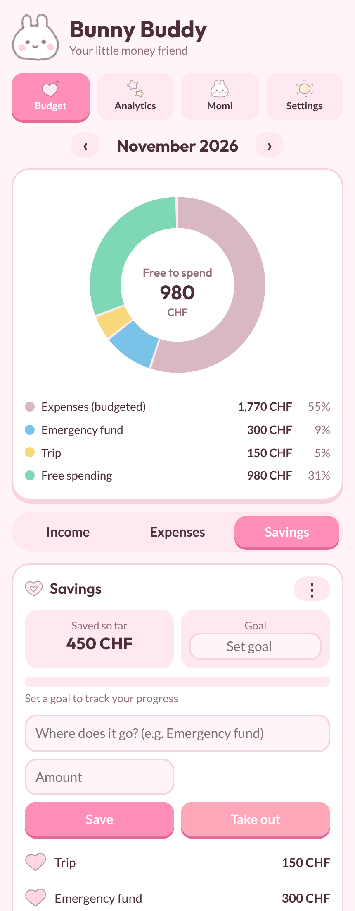
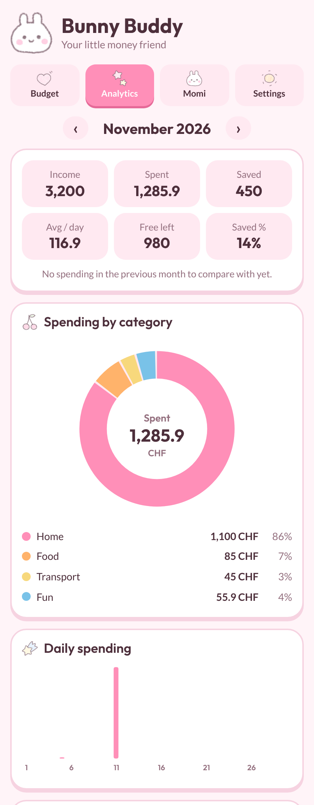

# Bunny Buddy

Bunny Buddy is your little money friend: a cute, pastel budgeting app that combines a monthly budget planner, savings tracker and spending analytics with a built-in AI buddy named **Momi**. Plan your income, set category budgets, track recurring subscriptions, decide where your savings go and see exactly how much is left for free spending, all in colourful donut charts. Whether you're budgeting for the first time or just want a friendlier way to look at your money, Bunny Buddy keeps everything simple, visual and private on your own device.

## Screenshots

| Budget | Analytics |
| :---: | :---: |
|  |  |

## Features

### Core Functionalities

1. **Monthly Budget Planner**
   * **Income:** Add as many income sources as you like and mark them as *repeats monthly* so they carry into every following month.
   * **Expenses:** Set a budget per category, log expenses with a date, and watch the progress bars fill up. Add your own categories with a sticker or any emoji.
   * **Savings:** Record *where* your money goes (for example "Emergency fund" or "Trip"), set a savings goal, and take money out when you need it.
   * **Free spending:** At the bottom of the Savings tab, see what is left to spend freely after expenses and savings: `income − expenses − savings`.
   * **Donut diagrams:** Every sub-tab is shown as a circle diagram (income sources, spending by category, or the full split of expenses, savings and free spending).

2. **Subscriptions**
   * Add recurring payments such as streaming or a phone plan once, and they show up automatically in every month from then on.
   * Tick ✓ each month when the payment has gone through.

3. **Analytics**
   * Income, spent, saved, average spend per day, free money left and savings rate for the selected month.
   * Comparison with the previous month.
   * Spending by category, daily spending chart, a 6-month income vs. spent chart and your biggest expenses.

4. **Momi, the AI Buddy**
   * Ask questions like "Where is my money going?" or "How can I save more?" and get short, friendly answers based on your own numbers for the selected month.

### Personalisation

* **10 colour themes:** Pink (default), Rose, Forest, Black, White, Lavender, Ocean, Matcha, Sunset and Midnight.
* **Hand-drawn stickers** instead of generic emojis, plus a picker with about 1,600 emojis for custom categories.
* **Currency** setting (default CHF).
* **Hidden edit mode:** Delete buttons stay out of the way until you press the ⋮ menu on a card.

## How It Works

| Tab | What it does |
| --- | --- |
| **Budget** | Income, Expenses (category budgets, expenses, subscriptions) and Savings, with a month switcher and a donut chart |
| **Analytics** | Charts and stats for the selected month |
| **Momi** | Chat with your AI buddy |
| **Settings** | Colour themes, currency and your API key |

## Technical Details

### Frontend

* **HTML, CSS and vanilla JavaScript:** One self-contained `index.html`, no framework and no build step.
* **SVG:** Donut and bar charts are drawn with plain SVG.
* **Fonts:** Lato for body text and Outfit for headlines, bundled locally (SIL Open Font License) so the app works offline. If you have Gilroy installed, headlines use it automatically.

### Desktop App

* **Electron:** Wraps the page as a Windows and macOS app.
* **@electron/packager:** Builds the `.exe` and `.app` bundles.

### AI

* **Anthropic Messages API:** Momi calls `https://api.anthropic.com/v1/messages` directly from the app using your own API key. The model is set in `index.html` (`claude-haiku-5-5` by default).

### Data

* **Local storage:** Everything you enter is saved on your device. There is no server, no account and no tracking.
* **Your API key** is stored on your device only and is sent only to Anthropic when you chat with Momi.

## Key Features

* **Plan Your Month:** See income, expenses, savings and free spending in one place.
* **Track Subscriptions:** Recurring costs appear in every month automatically.
* **Savings Buckets:** Know exactly what you put where.
* **Visual Analytics:** Donut and bar charts instead of spreadsheets.
* **Ask Momi:** Get answers about your own budget in plain language.
* **Private by Design:** Your data never leaves your device.

## Getting Started

### Prerequisites

* [Node.js](https://nodejs.org/) 18 or newer

### Run the App

```bash
git clone https://github.com/<your-username>/bunny-buddy.git
cd bunny-buddy
npm install
npm start
```

You can also open `index.html` directly in a browser to try it without Electron.

### Build the Desktop App

```bash
npm run package:win   # Windows (x64)
npm run package:mac   # macOS (Apple Silicon and Intel)
```

The packaged apps are written to the `dist/` folder.

**macOS note:** The app is not signed by Apple. If macOS says it is damaged, run:

```bash
xattr -cr /Applications/BunnyBuddy.app
codesign --force --deep --sign - /Applications/BunnyBuddy.app
```

**Windows note:** If SmartScreen warns you, click *More info* and then *Run anyway*.

### Set Up Momi

1. Create an API key in the [Anthropic Console](https://console.anthropic.com/).
2. Open **Settings** in Bunny Buddy and paste the key into the *Momi’s brain* box.
3. Open the **Momi** tab and start chatting. Usage is billed to your own Anthropic account.

## Project Structure

```
bunny-buddy/
├── index.html     # The whole app: markup, styles and logic
├── main.js        # Electron entry point
├── package.json
├── fonts/         # Bundled Lato and Outfit font files
├── icon.png       # Window icon
├── icon.icns      # macOS app icon
└── docs/          # README screenshots
```

## Credits

* Sticker artwork: *add the artist's name and licence here before publishing.*
* Fonts: [Lato](https://fonts.google.com/specimen/Lato) and [Outfit](https://fonts.google.com/specimen/Outfit), both under the SIL Open Font License.

## License

The code is released under the [MIT License](LICENSE). The sticker artwork is not covered by this license.
